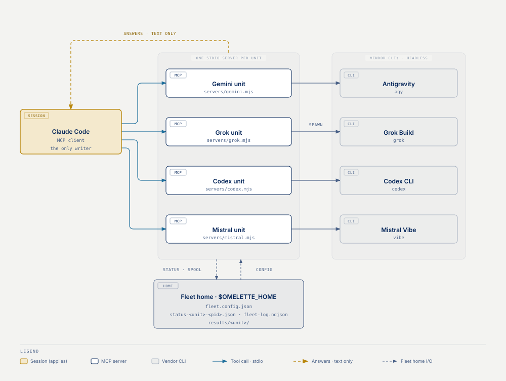
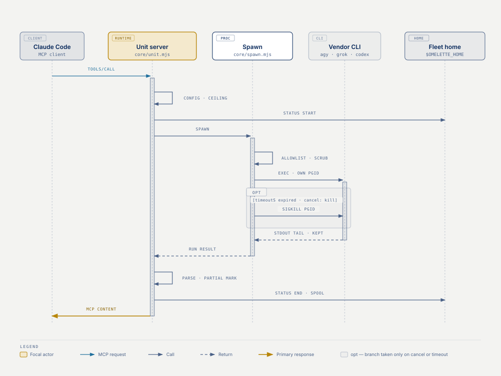
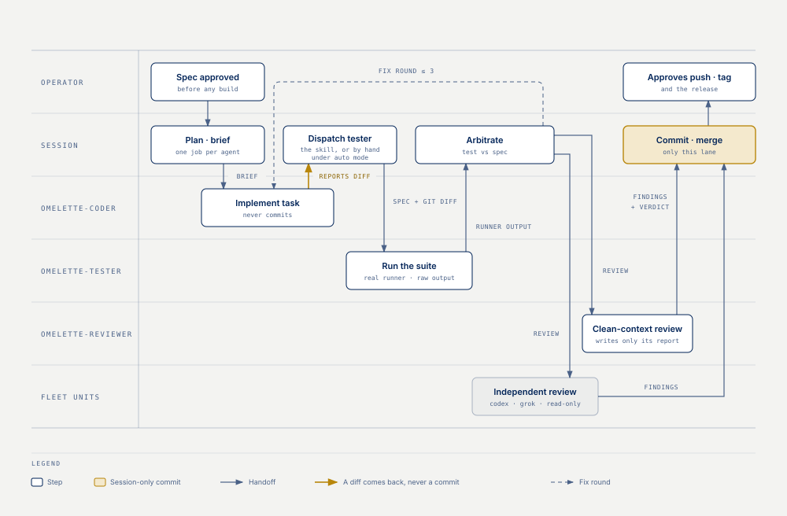

<p align="center">
  
</p>

<h1 align="center">Omelette Fleet</h1>

<p align="center">Gemini, Grok and Codex as read-only units in Claude Code</p>

<p align="center">
  <a href="https://github.com/adxd-og/omelette-fleet/actions/workflows/test.yml"></a>
  <a href="LICENSE"></a>
  
  
</p>

| Question | Where |
|---|---|
| What is this, and who is it for? | [What it is](#what-it-is) |
| How do I install it and wire it into a project? | [Quickstart](#quickstart) |
| What can I ask the units to do? | [What you can ask it](#what-you-can-ask-it) |
| How does my session work with the units? | [How a session works with it](#how-a-session-works-with-it) |
| Can a unit change my code? | [Is it really read-only?](#is-it-really-read-only) |
| Where is everything else? | [Documentation](#documentation) |
| Why CLIs, why read-only, and how does it compare to similar tools? | [FAQ](#faq) |

## What it is

Omelette Fleet adds three outside models to Claude Code as research and review peers: Google Gemini, xAI Grok and OpenAI Codex. Each one is a **unit**: a small MCP server (the way Claude Code talks to tools) that runs the vendor's own CLI, `agy`, `grok` or `codex`, on the subscription you already pay for. It is for people who work in Claude Code and want a second vendor's research or review without leaving the session. The one rule: **units propose, the session applies.** A unit reads, searches and reviews, and hands back text. Your Claude Code conversation, the **session**, decides what to do with that text, and it is the only thing that changes your code.



## Quickstart

You need Node 20 or newer, Claude Code, and at least one of `agy`, `grok` or `codex`, installed and logged in. It runs on macOS and Linux; on Windows, use WSL. The package is not on npm: you run it from a git clone.

1. Get the code:
   ```bash
   git clone https://github.com/adxd-og/omelette-fleet.git
   ```
2. Register the units with Claude Code, one MCP server per vendor CLI it finds:
   ```bash
   omelette-fleet/bin/omelette-fleet.mjs install
   ```
3. Go to the project you want the fleet in:
   ```bash
   cd /path/to/your/project
   ```
4. Give that project the rules, the sub-agent definitions and the guard, using the clone's absolute path:
   ```bash
   /path/to/omelette-fleet/bin/omelette-fleet.mjs rules --agents --hooks
   ```
5. Check the install:
   ```bash
   /path/to/omelette-fleet/bin/omelette-fleet.mjs doctor
   ```

Then merge the settings snippet that step 4 printed into the project's `.claude/settings.json`, restart Claude Code, and run `doctor` again: it prints one `next` line until nothing is missing. Logging in to each CLI, what each step writes, every `doctor` line and how to update: [docs/INSTALL.md](docs/INSTALL.md).

## What you can ask it

| You want | Ask |
|---|---|
| Grounded web research, with sources | `gemini_research` (Gemini) |
| Deep research across many sources, about five CLI runs and several minutes per call | `gemini_deep_research` (Gemini) |
| A cheap second opinion or a mechanical review sweep; verify every fact it states | `grok_research`, `grok_code_review` (Grok) |
| The strongest code review, given an absolute `cwd` | `codex_code_review` (Codex), on `gpt-6.1-sol` (xhigh) by default |
| An image, or an edit of one | `gemini_image`, `grok_image`, `codex_image`; `grok_image_edit` edits |
| The answer to a call your client timed out on | `<unit>_result` on the same unit: every answer is saved before it is sent |

Each unit also has a `<unit>_models` tool: its models, and which tasks belong on each. The full routing table: [ORCHESTRATION, "Routing by task"](docs/ORCHESTRATION.md#routing-by-task). Every unit writes what it is doing to a status feed under `~/.omelette`, which a menu-bar app, a HUD or `tail -f` can read; [Omelette usage-checker](https://github.com/adxd-og/usage-checker) is one reader ([STATUS-FEED](docs/STATUS-FEED.md)).

One call, from Claude Code to the vendor CLI and back:



## How a session works with it



- **The session orchestrates.** It plans, routes each job, reviews every result, and commits.
- **The coder codes.** `omelette-coder` is a **sub-agent**, a helper Claude the session starts for one job; it builds from the approved plan.
- **The tester tests with the real diff.** `omelette-tester` gets the diff from git, never the coder's summary, and runs the real test runner.
- **The units propose.** Research, reviews and second opinions come back as text for the session to check.

The **guard**, an optional hook script, refuses a `git commit` by the shipped sub-agents, so only the session commits. How the rules reach a session, the plan ledger that survives a compaction, and the reviews: [docs/ORCHESTRATION.md](docs/ORCHESTRATION.md).

## Is it really read-only?

- **Closed by default.** No unit can write to your project while `OMELETTE_ALLOW_WRITE` stays closed (the default). The image tools save outside it: in a temp directory, or in Grok's own session directory.
- **Two keys open it.** A unit writes only when the config file sets its `mode` to `workspace-write` *and* the unit is named in `OMELETTE_ALLOW_WRITE`, in the MCP server's environment. The config alone can only narrow.
- **The strength differs by vendor.** Codex runs inside a kernel sandbox. Grok refuses write mode outright. Gemini rests on agy's own permission policy, so it holds only while your agy settings allow no edit or shell tool: the weakest of the three.

The threat model, each unit's layers and what is only best-effort: [docs/SECURITY.md](docs/SECURITY.md). To test it on your own machine: `doctor --probe-sandbox` ([INSTALL](docs/INSTALL.md#the-sandbox-probe)).

## Documentation

New here? Read [INSTALL](docs/INSTALL.md), then [ORCHESTRATION](docs/ORCHESTRATION.md). Each doc opens with a map of the questions it answers.

| If you want to know… | Read |
|---|---|
| How to install, wire a project, and keep it up to date | [docs/INSTALL.md](docs/INSTALL.md) |
| What each `doctor` line means, and what its `next` line wants | [INSTALL, What doctor tells you](docs/INSTALL.md#what-doctor-tells-you) |
| How to stop approving every unit call by hand | [INSTALL, Fewer permission prompts](docs/INSTALL.md#fewer-permission-prompts) |
| Which subcommands the CLI has | [INSTALL, CLI](docs/INSTALL.md#cli) |
| Who decides, who proposes, and which unit gets which task | [docs/ORCHESTRATION.md](docs/ORCHESTRATION.md) |
| How the rules, the sub-agents and the guard reach my session | [ORCHESTRATION, How the rules reach a session](docs/ORCHESTRATION.md#how-the-rules-reach-a-session) |
| Which model or effort a task wants | [ORCHESTRATION, Model and effort escalation](docs/ORCHESTRATION.md#model-and-effort-escalation) |
| Which model and effort each shipped sub-agent runs on, and why | [ORCHESTRATION, Effort by role and model](docs/ORCHESTRATION.md#effort-by-role-and-model) |
| What not to trust a unit with | [ORCHESTRATION, Never a sole source](docs/ORCHESTRATION.md#never-a-sole-source) |
| How to keep a plan across a compaction | [ORCHESTRATION, Ledger and handoff](docs/ORCHESTRATION.md#ledger-and-handoff) |
| Which config keys exist, what they default to, and how they resolve | [docs/CONFIG.md](docs/CONFIG.md) |
| Which client timeout cut my call short | [CONFIG, Client timeouts](docs/CONFIG.md#client-timeouts) |
| Where the answer of a call that timed out went | [CONFIG, What the result spool keeps](docs/CONFIG.md#what-the-result-spool-keeps) |
| What the handoff hooks do to my ledger | [CONFIG, The handoff hooks](docs/CONFIG.md#the-handoff-hooks) |
| What this project has decided and still holds to | [docs/DECISIONS.md](docs/DECISIONS.md) |
| How strong each unit's read-only enforcement actually is | [docs/SECURITY.md](docs/SECURITY.md) |
| What the guard hook blocks | [SECURITY, The guard hook](docs/SECURITY.md#the-guard-hook) |
| Letting Gemini read local files | [SECURITY, Recommended agy allow-rules](docs/SECURITY.md#recommended-agy-allow-rules) |
| What the fleet sends over the network | [SECURITY, Network](docs/SECURITY.md#network) |
| What the fleet writes to disk | [SECURITY, What the fleet writes down locally](docs/SECURITY.md#what-the-fleet-writes-down-locally) |
| What the status feed looks like and how to read it | [docs/STATUS-FEED.md](docs/STATUS-FEED.md) |
| Whether a call finished, came back partial, was cancelled or failed | [STATUS-FEED, What ok, error and cancelled mean](docs/STATUS-FEED.md#what-ok-error-and-cancelled-mean) |
| How to see the fleet at work in a pane, and what the pane reads | [docs/MODS.md](docs/MODS.md) |
| How the pieces fit, why three servers, and what one call goes through | [docs/ARCHITECTURE.md](docs/ARCHITECTURE.md) |
| How to add a fourth unit | [docs/ADAPTERS.md](docs/ADAPTERS.md) |
| What has been measured — planning cost, review yield, `check` before and after — and what has not | [docs/MEASUREMENTS.md](docs/MEASUREMENTS.md) |
| What changed release to release | [CHANGELOG.md](CHANGELOG.md) |

## FAQ

**Why CLIs instead of API keys?**
Billing and safety. Each vendor CLI signs in to the subscription you already pay for. An API key in the environment would switch some of them to metered billing, so the fleet removes those keys from the child process. Each CLI also ships its own sandbox and permission machinery, which the fleet drives instead of rebuilding it on a raw API ([ARCHITECTURE](docs/ARCHITECTURE.md#why-spawn-clis-not-call-apis); the child environment: [SECURITY](docs/SECURITY.md#the-environment-allowlist)).

**Why read-only?**
A review peer that can also write is one you have to supervise twice. Units read, search, analyse and propose; Claude Code applies the change, where your approval flow already sits. It also contains prompt injection: a unit that reads a hostile web page or repository can only report back, not act.

**Can I let a unit write?**
Only on purpose, with both keys. Even then Codex writes only inside the `cwd` you pass to `codex_code_review`, Gemini uses agy's own permission layer, and Grok refuses: [SECURITY, "The ceiling"](docs/SECURITY.md#the-ceiling).

**How does it compare to codex-plugin-cc or pal?**
Both drive vendor CLIs from inside Claude Code. [codex-plugin-cc](https://github.com/openai/codex-plugin-cc) is OpenAI's own plugin: Codex only, reviews run read-only with approvals off, one command (`/codex:rescue`) writes to the workspace, and a Stop hook can run a review and hold the session until it passes. [pal](https://github.com/BeehiveInnovations/pal-mcp-server) is one MCP server over several CLIs: it starts Codex with `--dangerously-bypass-approvals-and-sandbox`, Gemini with `--yolo` and Claude with `--permission-mode acceptEdits`, and a client timeout loses the answer (its docs say to raise `MCP_TOOL_TIMEOUT`). What this package does differently, on purpose:

- **Read-only by the vendor's own enforcement**, and never a `--dangerously-*` flag in any mode ([SECURITY](docs/SECURITY.md#what-this-package-never-does)).
- **A client timeout loses nothing**: every answer is saved before it is sent, and `<unit>_result` returns it ([CONFIG](docs/CONFIG.md#what-the-result-spool-keeps)).
- **No hook holds the session**: the guard refuses calls, stamps ledgers and prints the handoff, and never blocks a stop or a compaction; only the pane mod's opt-in `handoffGate` skips one ([MODS](docs/MODS.md#the-handoff-entry-and-the-compaction-skip)).
- **One child environment**, built from an allowlist with the billing keys scrubbed, and a status feed that shows what each unit is doing ([STATUS-FEED](docs/STATUS-FEED.md)).

**How do I add a unit?**
Three files and a test, plus a few places in the CLI and the pane that name the units by hand: [docs/ADAPTERS.md](docs/ADAPTERS.md).

## License

MIT — see [LICENSE](LICENSE).
