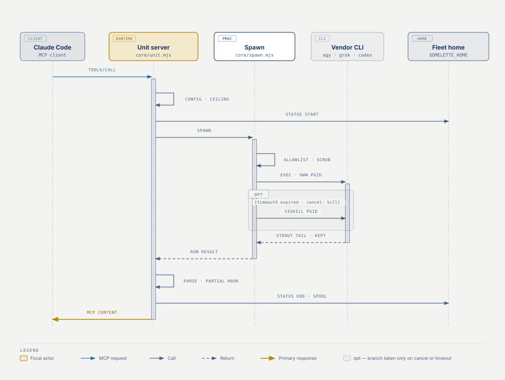

# Architecture

Three layers, one direction of dependency: `servers/` → `units/` → `core/`.

```
servers/<unit>.mjs     entrypoint: import the adapter, startUnit(unit)
units/<unit>/          adapter.mjs (vendor knowledge) + models.js (catalog)
core/                  everything that is not vendor-specific
```

| Question | Where |
|---|---|
| What does each file under `core/` actually own? | [core/](#core) |
| What must a unit adapter declare to `defineUnit`? | [The adapter contract](#the-adapter-contract) |
| What happens, step by step, when a tool is called? | [The path of one call](#the-path-of-one-call) |
| Why is each unit its own MCP server instead of one shared server? | [Why three servers, not one](#why-three-servers-not-one) |
| Why spawn the vendor CLI instead of calling its API directly? | [Why spawn CLIs, not call APIs](#why-spawn-clis-not-call-apis) |
| How is a unit's model catalog kept accurate over time? | [How catalogs are curated](#how-catalogs-are-curated) |

## core/

| Module | Owns |
|---|---|
| `unit.mjs` | The `defineUnit` contract, validation, and the generic tool runtime (`createUnitRuntime`, `startUnit`). Also `MUTATE_RE`, the git/deploy intent pattern, and `boundedRetry`. |
| `config.mjs` | `fleet.config.json` resolution, the key schema, and the write-mode **ceiling**. |
| `catalog.mjs` | `makeCatalog()` — the model/effort allowlist and the rendered cheat-sheet behind every `<unit>_models` tool. |
| `rules.mjs` | Every text that tells a session how to work with the fleet: `FLEET_CONTRACT`, the one-line `SHORT_CONTRACT`, `contractFor()` — which of the two a server sends, decided by the rendered rules file in its cwd and the `contract` key — and `unitInstructions()` behind each server's `initialize.instructions`, plus the `rules/` and `agents/` templates, their version markers and their target paths — the marker is what makes a file the CLI's to refresh or remove — and the guard hook's event list and settings snippet (`HOOK_EVENTS`, `hookSettingsSnippet`). |
| `spawn.mjs` | One bounded child process: own process group, wall-clock SIGKILL, output caps, the **child-environment allowlist** and billing scrub, actionable ENOENT. |
| `status.mjs` | The schema-2 status feed (per-process snapshot + shared NDJSON log), fail-soft. |
| `results.mjs` | The result spool: every spawned answer is filed under `<home>/results/<unit>/<resultId>.md` before the client is told anything, and read back by `<unit>_result` and `omelette-fleet results`. Fail-soft and atomic; reads never follow a symlink. |
| `partial.mjs` | The one rule for `partial`: `partialMark()` builds the `[<unit>: …]` marker, `withPartial()` appends it and sets the flag in one operation, `PARTIAL_MARK_RE` matches every marker. Adapters never spell a marker themselves. |
| `artifact.mjs` | `extractImagePath()` — the shared scan behind every image tool: return a path that exists **on disk**, never one the model merely asserted, and only an image file dated by the run itself. `newestImage()` reads the same answer off a run's own directory when the run never got to name it. |
| `cwd.mjs` | `checkCwd()` — the one pre-spawn check on a caller's run directory (absolute, exists, is a directory) and the one wording every tool that takes a `cwd` refuses with. |
| `jsonrpc.mjs` | Newline-delimited JSON-RPC 2.0 over stdin/stdout — the MCP stdio transport. `createHandler` is pure and testable; `serve` wires it to the process. |
| `client.mjs` | The other side of the same transport: drive one unit server the way a real client does. Behind `omelette-fleet call`, `scripts/mcp-call.mjs` and the end-to-end tests. Every way a call can die is a rejection that does not wait out the timeout — a JSON-RPC `error` reply to any of the three requests, a child that exits, a stdin that closes under an unanswered request — and the timeout itself is clamped to 1–86400 s, because Node's int32 timers turn a larger value into an instant false "no answer". |
| `update.mjs` | "Is there a newer fleet?" — one unauthenticated GitHub releases call, cached on disk for 24 h, capped at 2.5 s, and never in the way of a tool call. Also owns the package version every server reports in `initialize`, the semver comparison, and the git-vs-npm install detection behind `omelette-fleet update`. |
| `check.mjs` | The mechanical half of `omelette-fleet check`: reads a report and says, for every `path:line · fragment · claim` pointer, whether the fragment is still on that line. |
| `ledger.mjs` | The ledger lifecycle behind `omelette-fleet ledger`: a ledger's `branch:` header and its state (open, closed, standing, untracked) read through `git show-ref`. Writes only under the project's `.omelette/` and to the decisions register. |
| `log.mjs` | stderr-only logging. stdout belongs to JSON-RPC; one stray byte there and the client shows the server as offline. |

A unit adapter never touches stdin/stdout, never reads the config file, never spawns directly, and never writes the status feed. It declares what is vendor-specific and receives everything else through `ctx`.

## The adapter contract

`defineUnit(spec)` validates the spec loudly at import time — a bad tool kind, a duplicate tool name, a missing `run()`, a name that is not `[a-z][a-z0-9-]*`, or a catalog that did not come from `makeCatalog()` all throw before the server starts.

```js
defineUnit({
  name: 'codex',                       // [a-z][a-z0-9-]*; also the config key and status unit
  label: 'Codex',                      // human name in error messages
  instructions: 'This unit: Codex …',  // one line appended to the fleet contract in initialize.instructions
  bin: { env: 'CODEX_BIN', default: 'codex' },
  riskEnv: ['OPENAI_API_KEY', 'CODEX_API_KEY', 'CODEX_EXEC_SERVER_URL'],  // deleted from every child env
  envPassthrough: ['CODEX_HOME', 'CODEX_ACCESS_TOKEN', 'RUST_LOG', 'CODEX_EXEC_SERVER_EXIT_ON_STDIN_CLOSE'],   // exact names added to core/spawn.mjs's ALLOWED_ENV for this unit's
                                       // children only; defineUnit refuses a PREFIX_* pattern. Everything
                                       // else is NOT inherited.
  envMap: { model: 'CODEX_DEFAULT_MODEL', effort: 'CODEX_EFFORT', timeoutS: 'CODEX_TIMEOUT_S', webSearch: 'CODEX_WEB_SEARCH' },   // env overrides
  builtin: { timeoutS: 600, effort: 'xhigh', webSearch: true, outputCap: CODEX_OUTPUT_CAP },   // unit defaults for config keys
  extraSchema: { imageMaxTurns: { type: 'posint', default: 8 } },          // unit-only config keys (grok's; codex declares none)
  supportedModes: { 'read-only': true, 'workspace-write': true|null },     // null = refuse that level
  auth: { detect: (stderr) => bool, help: 'run `codex login`' },           // checked on empty-stdout runs only
  pairedEffort: true,                  // codex only: an omitted effort takes the model's catalog pairing unless the operator configured an effort (core/unit.mjs, EFFORT)
  catalog: makeCatalog({ models, efforts, guide, title }),
  tools: [{ name, description, inputSchema, kind, mutateGate?, run(args, ctx) }],
})
```

Defaults filled in by `defineUnit`: `version`: the package version (`VERSION` from `core/update.mjs`), `serverName: 'omelette-<name>'`, `label: <name>`, `instructions: ''` (a unit that leaves it empty adds no routing line for itself to the fleet contract), empty `riskEnv` / `envPassthrough` / `envMap` / `builtin` / `extraSchema`, `supportedModes: { 'read-only': true, 'workspace-write': null }`, `auth: null`, `pairedEffort: false`. A string `bin` is normalised to `{ env: null, default: bin }`.

**Tool kinds** — `research | review | image | pipeline | catalog | local`: a `catalog` tool never spawns (the runtime answers it locally with `catalog.render()`), and every other kind supplies `run(args, ctx)` — what `ctx` holds, what `spawn` resolves to and each shape `run()` may return, `isError` and `partial` included, are tabled in [ADAPTERS, "What `ctx`, `spawn` and `run()` hand each other"](ADAPTERS.md#what-ctx-spawn-and-run-hand-each-other).

**`mutateGate: true`** puts the tool's `prompt` through `MUTATE_RE` (`git push|commit|merge|rebase|reset|tag`, `npm publish`, `deploy`) and rejects the call before any spawn. It is applied per tool, not globally, because "review the last git commit" is a legitimate read-only ask for a review tool.

`tools/list` is derived from the same array with `run`, `kind` and `mutateGate` stripped, so the MCP shape and the implementation can never drift. The array is the adapter's `tools` plus one `local` tool the runtime appends to every unit, `<unit>_result` (it hands back a spooled answer); an adapter that declares a tool of that name keeps its own.

## The path of one call

The picture is the shape of the call; the list under it is the detail the picture leaves out. Two things the picture folds away: a client cancellation under `cancel: kill` takes the same hard kill as the timeout, but its response is dropped (a cancelled request gets none) and the captured text lives on only in the spool (on by default; `results=false` turns it off), reachable through `<unit>_result`; and Gemini's timeout carries a 60 s grace (`HARD_KILL_GRACE_MS`) between `timeoutS` and the kill, so agy's own `--print-timeout` gets to end the run first.



1. **Client → transport.** Claude Code writes a newline-delimited JSON-RPC frame to the server's stdin. `createLineSplitter` reassembles frames across arbitrary chunk boundaries; a frame that is not JSON is dropped without killing the loop, and so is any single frame that passes 16 MiB without a newline — it is dropped with one stderr line rather than growing the buffer until the process dies.
2. **`tools/call` → runtime.** `createHandler` routes to `callTool(name, args)`. An unknown tool name returns a clean error result.
3. **Catalog short-circuit.** If the tool's kind is `catalog`, the rendered catalog is returned. No config, no spawn, no status entry. A `local` tool takes a similar exit one step later: once step 4 has resolved the config, the runtime runs it in-process with a reduced `ctx` and answers. It skips everything below — the `enabled` check, the feed and the spool — which is how `<unit>_result` answers while a unit is disabled.
4. **Config.** `unitConfig()` resolves every key: built-in default → file `defaults` → file `units.<unit>` → environment. Warnings are logged once per process, never repeated per call.
5. **Ceiling.** `effectiveMode()` has already run inside the config resolution: a requested `workspace-write` survives only if the unit implements it *and* the machine env lists the unit in `OMELETTE_ALLOW_WRITE`. Otherwise it is narrowed to `read-only` with a warning.
6. **Model / effort selection.** An explicit `model` argument wins; otherwise the configured default is used *if* it is in the catalog (an unknown configured default is ignored with a warning and the vendor default applies). A unit that ignores its vendor's config file — Codex — pins the catalog head here instead of leaving the model unset.
7. **Status start.** `status.start()` opens an `active` entry and appends a `start` line to the log. It runs before the disabled check and before validation on purpose, so a refused call still produces a matching `end` event.
8. **Disabled unit, then catalog validation.** `enabled: false` fails the call here, after the feed has started it, so a disabled unit writes a `start`/`end` pair and a spooled record. Then an explicit model or effort that is not in the allowlist is a hard error with the allowed ids listed — no process is spawned to be told the same thing.
9. **Mutate gate.** For tools declaring `mutateGate`, git/deploy/publish intent in the prompt is rejected here.
10. **Adapter `run(args, ctx)`.** The vendor-specific part: build argv, choose a sandbox/toolset, wrap the prompt.
11. **Spawn.** `runProcess` starts the CLI in its **own process group** (so a timeout can SIGKILL the whole tree), keeps only the tail of stdout and of stderr (8 KB), feeds the prompt on stdin when the adapter asks, and **builds the child environment from an allowlist** — `ALLOWED_ENV`, plus the unit's `envPassthrough` exact names, plus `OMELETTE_ENV_PASSTHROUGH` (names or `PREFIX_*` patterns), then the scrub (`riskEnv`), then the adapter's own additions. Nothing else is inherited. The stdout tail is the unit's `outputCap`, counted in characters (string length), not bytes: 400 000 by the schema default (Gemini keeps it), 10 000 000 for Grok's built-in, 4 000 000 for Codex's. It never rejects on a non-zero exit — the adapter decides what an exit code means for that CLI. A missing binary rejects with an actionable "install X" message.
12. **Auth check.** Only on a run with empty stdout: if `auth.detect(stderr)` matches, the adapter's `auth.help` becomes the error. A real answer that merely mentions signing in can never false-positive.
13. **Vendor parse.** The adapter turns the raw run into text — Codex reads the last `agent_message` from its event stream and the usage from `turn.completed`; Gemini reads `status`/`response` from agy's JSON envelope; Grok assembles the text, `stopReason` and usage from the NDJSON stream its research and review runs emit (image runs stay on plain stdout). A run that finished badly but produced text — a non-zero exit, an early stop, or the hard kill at the wall-clock timeout (`timeoutS`; Gemini gets 60 s more) — keeps the text under a visible partial marker, read out of the captured output by the same parsing a clean run gets; only a text-less failure throws.
14. **Status end and spool.** `status.end()` closes the entry as `ok`, `error` or `cancelled` (a client cancel under `cancel: kill`), with duration, truncated error text, and any `usage` the adapter returned. The answer is written to the result spool (`<home>/results/<unit>/<resultId>.md`; `results=false` turns it off) before the response is sent, so it survives a request the client dropped. Then the result goes back over stdout as MCP `content`, carrying `isError` when the adapter or the runtime said so.

Nothing in that path waits on the network. The startup update announcement is fire-and-forget: `startUnit` hands it off without awaiting, the server is already serving before the request leaves, and `core/update.mjs` guarantees the promise cannot reject — at worst one stderr line arrives late, and a call in flight never notices.

## Why three servers, not one

- **Failure isolation.** A vendor CLI that hangs, a missing binary, or a bug in one adapter takes down one server. The other units keep answering; the client shows exactly which one is offline.
- **Stable tool names.** Each server owns a fixed tool list under a fixed server name, so `mcp__<prefix>-<unit>__<tool>` never changes because a different unit was installed, removed, or disabled. A single multiplexed server would have to renumber or namespace its tool list dynamically, and a partial fleet is the normal case here.
- **Independent posture.** Each unit gets its own config block, its own timeout, its own ceiling decision and its own billing-scrub list, enforced in its own process.

The cost is one idle Node process per unit, which does nothing until a call arrives.

## Why spawn CLIs, not call APIs

- **Subscriptions.** The vendor CLIs authenticate against the plan you already pay for. Calling the raw API instead would mean a metered bill and a second set of credentials to manage. The same reason drives the scrub list: with an API key visible in the environment, some of these CLIs silently prefer it over the browser/OAuth credentials, which turns every fleet call into real metered spend.
- **The CLI's own machinery is part of the posture.** Codex ships an OS-level sandbox (Seatbelt on macOS, Landlock/seccomp on Linux); Grok ships a toolset allowlist plus a deny/ask/allow permission engine; agy ships a permission policy with headless auto-deny. Driving those flags is enforcement that a raw API client would have to invent — and would get wrong. See [SECURITY.md](SECURITY.md) for what each layer actually guarantees.
- **The CLIs already do the agentic work.** File reading, grep, web search and tool loops exist in the CLI. The adapters constrain them; they do not reimplement them.

The flip side is that a CLI is a program with an environment and a config file of its own, and both are inputs the fleet has to decide about rather than inherit. The child environment is built from an allowlist, and a vendor config file that can carry executable behaviour — MCP servers, hooks, plugins — is ignored where the CLI lets us ignore it (Codex's `--ignore-user-config --ignore-rules`). What that costs, and what it means for "the vendor default", is in [SECURITY.md](SECURITY.md).

## How catalogs are curated

Each unit ships a `models.js` holding the model list, the `model` allowlist, the optional `effort` allowlist, and a compact `GUIDE` string that rides in every `tools/list` payload. Rules:

- **Ids are exact.** They are the literal strings the CLI accepts (`grok --model "<id>"`, `codex exec -m <id>`, `agy --model "<id>"`). Spawn uses an argv array, never a shell, so spaces and parentheses in an id are one safe element.
- **The allowlist is a correctness gate, not a convenience.** A typo is rejected locally with the valid ids, without paying for a process spawn to be told the same thing — and if a CLI generation ever goes back to silently falling back to its default on an unknown `--model`, this gate is what stops a typo from quietly running on the wrong model. It also carries policy: a model the CLI would happily run can be kept out of the fleet path deliberately.
- **The newest generation leads; the old one is retired by hand.** When a vendor ships a new generation, it goes first. A superseded entry may stay for a while, marked as such in its own text (Codex's `gpt-5.6-*` entries read `SUPERSEDED by gpt-6-…`), and a fallback may stay beside the new head (Grok keeps `grok-4.6` in case a `grok-4.7` regression surfaces). Removing a retired entry, and restoring one, is an edit by hand.
- **Ids are verified live, and the date is recorded.** Each `models.js` header states which CLI version was checked, on what date, and how (one trivial call per id, success = a completed turn). What the binary embeds is not the same as what an account accepts — the Codex header records exactly which ids a ChatGPT-plan account accepted and which were rejected. **Effort values get the same treatment**, and for the same reason: a sweep that read the effort names out of the binary's strings shipped a `minimal` that every model in the catalog rejects with an HTTP 400, so they are now probed with a real one-shot too.
- **Numbers are sourced or absent.** `useFor` / `avoid` carry benchmark figures with their harness and provenance, and explicitly name the axes that are *not published* for a model so the next sweep does not silently upgrade an inherited claim.
- **Catalogs are edited in place.** No `models.js` is synced from anywhere now (`units/gemini/models.js` says so in its header), so the file in the repository is the only source and nothing needs to stay identical to an origin. `makeCatalog()` still takes the models array as data, so each `models.js` stays plain ESM with no import from `core/`.

Consequence for the docs: any model id or benchmark number in this repository's documentation comes from `units/<unit>/models.js` and nowhere else.
