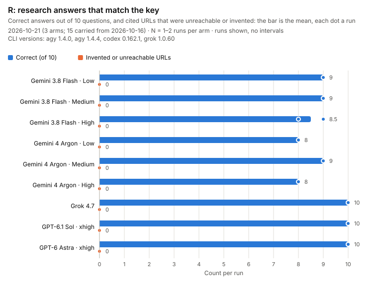
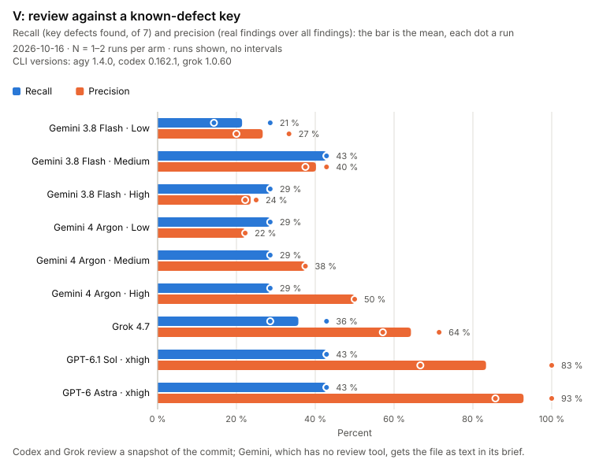
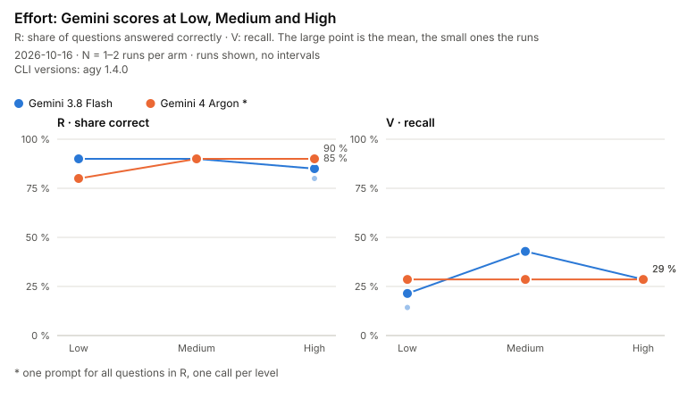
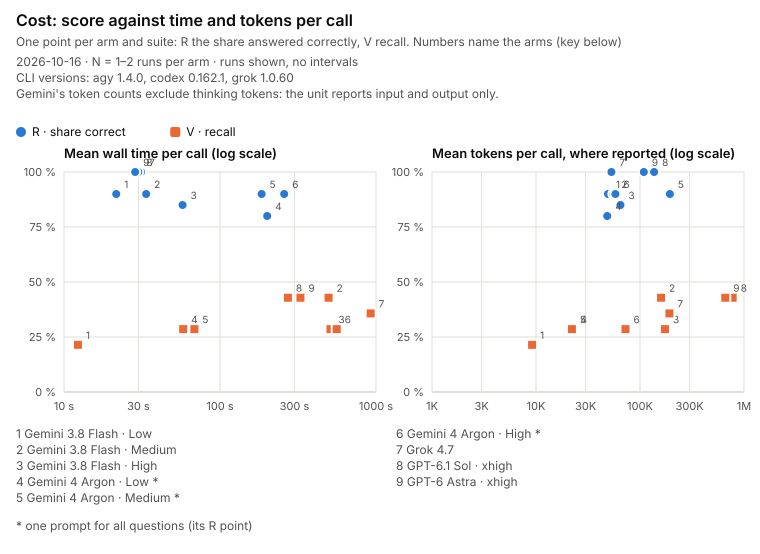

# Evals: the fleet's models on our own tasks

The unit catalogs describe each model from vendor model cards and public benchmarks: other people's tasks. These evals measure the models the fleet actually runs, through the fleet itself, on two kinds of task it is used for. Only the charts are published.

| Question | Where |
|---|---|
| What is measured, and on which models? | [What is measured](#what-is-measured) |
| How is a round run and graded? | [Method](#method) |
| What can the method not rule out? | [Limits of the method](#limits-of-the-method) |
| What did the last round show? | [Charts](#charts) |
| Why are the tasks, keys and answers not here? | [What is not published](#what-is-not-published) |
| How do I run a round? | [Re-running](#re-running) |

## What is measured

| Suite | Tasks | Graded |
|---|---|---|
| **R**, research | 10 questions, each answer checked against a primary source on a recorded date: stable facts and recent ones (model availability, CLI behaviour, dates) | Per question: correct, partly, wrong, no answer. Per cited URL: supports, real but not supporting, unreachable or invented |
| **V**, review | One past state of one of our files, keyed with the 7 defects the release reviews found and fixed in it | Recall (key defects found), precision (real findings, the key's or new ones the session verified, over all findings), false findings |

| Unit | Model | Effort | Runs |
|---|---|---|---|
| Gemini | Gemini 4 Argon | Low, Medium, High | 1 per level; R per question since 2026-10-21 (round one batched it: its quota is small) |
| Gemini | Gemini 3.8 Flash | Low, Medium, High | 2 per level, one question per call |
| Codex | gpt-6.1-sol, gpt-6-astra | xhigh | 2 each |
| Grok | grok-4.7 | the unit's default | 2 |

## Method

1. **Run.** `scripts/eval-run.mjs` calls each unit through its real server, as `omelette-fleet call` does, so the fleet's guards, sandboxes, timeouts and config apply. R goes to each unit's research tool. V goes to Codex's and Grok's review tools on a `git archive` snapshot of the commit, with no history reachable from it; Gemini has no review tool and gets the file as text. Each call records its answer, the model and effort the unit reports, the CLI version, the wall time and the token usage from the unit's own result record. A failed call is recorded as failed, never retried.
2. **Blind.** `scripts/eval-blind.mjs` strips model names, ids, tool names and CLI versions from every V answer (R answers are about models and are graded unredacted — see the limits), shuffles with a printed seed, and gives each answer a blind id. The mapping back to the model stays private.
3. **Grade.** A clean-context reviewer grades the blinded answers against the keys by a written rubric, told nothing about who wrote what. The session checks every uncertain grade, every claimed new defect and a random 10 % of the rest; a grade it overturns keeps both values and counts by the new one. A finding line that duplicates another in the same answer is dropped and recorded.
4. **Aggregate and draw.** `eval-blind.mjs --aggregate` turns the grades into numbers per arm and run; `scripts/eval-chart.mjs` draws them. A round that re-measures some arms only (`--merge <earlier date>`) carries the other arms from the earlier aggregate, each marked `carriedFrom`; the charts' captions say how many.

Read the numbers with their limits: one or two runs per arm (the charts show runs, not intervals), ten questions and one file, and a V input that differs by unit.

### Limits of the method

- **The snapshot hides history, not the disk.** Codex and Grok review read-only, but they can read files outside the snapshot. The snapshot keeps git history out of the review's cwd; it cannot hide files the operator's user can read. The prompts name no private path.
- **R answers are graded unredacted.** The questions are about models, so masking model names would make the answers ungradable.
- **Precision is the mean of per-run precision.** A run with no findings has no precision and is left out of that mean.
- **Gemini's token counts exclude thinking tokens.** The unit reports input and output only.

## Charts

Generated by `scripts/eval-chart.mjs` from the latest graded round; each caption names its date, the CLI versions and N.

**Argon's R arms are from 2026-10-21.** In round one (2026-10-16) Argon answered all ten R questions in one prompt, so its R score was not like-for-like with the other arms. On 2026-10-21 Argon was re-run per question (agy 1.4.4, 30 calls, none failed) and scored 8, 9 and 8 at Low, Medium and High, against 8, 9 and 9 in one prompt. The charts carry the other fifteen arms from round one; their captions say so. No Gemini answer cited a URL in either round, so the invented-URL count says nothing about Gemini.









## What is not published

- **The tasks and keys.** A published question with its answer stops being a test: it can be trained on, found by a search, or read out of this repository by the units under test, which read local files and search the web.
- **The raw answers and grades.** They quote the tasks and keys.

They live in `.omelette/evals/`, which git ignores; the scripts read and write only there — except the V review snapshot, which goes under the OS temp directory outside every git work tree — and hold no task text themselves. A test (`test/evals-leak.test.mjs`) fails if any line of a task or key appears under `evals/` or in `scripts/eval-*`. `evals/` is not part of the npm package.

## Re-running

From the repository root, with the suites in `.omelette/evals/suites/`. Each command takes `--dry-run`, which prints the calls by task id and makes none.

```sh
# Argon on R, one question per call (round one batched it; since 2026-10-21 it runs per question)
node scripts/eval-run.mjs --suite R --arm "gemini:Gemini 4 Argon:low" --arm "gemini:Gemini 4 Argon:medium" --arm "gemini:Gemini 4 Argon:high"

# Flash, Codex and Grok: two runs each, one question per call
node scripts/eval-run.mjs --suite R --runs 2 --arm "gemini:Gemini 3.8 Flash:low" --arm "gemini:Gemini 3.8 Flash:medium" --arm "gemini:Gemini 3.8 Flash:high" --arm codex:gpt-6.1-sol --arm codex:gpt-6-astra --arm grok:grok-4.7

# V: the review snapshot goes under the OS temp dir, outside every git work tree (--snapshot moves it)
node scripts/eval-run.mjs --suite V --arm "gemini:Gemini 4 Argon:low" --arm "gemini:Gemini 4 Argon:medium" --arm "gemini:Gemini 4 Argon:high"
node scripts/eval-run.mjs --suite V --runs 2 --arm "gemini:Gemini 3.8 Flash:low" --arm "gemini:Gemini 3.8 Flash:medium" --arm "gemini:Gemini 3.8 Flash:high" --arm codex:gpt-6.1-sol --arm codex:gpt-6-astra --arm grok:grok-4.7

# Blind and grade the new date; aggregate it with the arms carried from the earlier round; draw
node scripts/eval-blind.mjs --date 2026-10-21
node scripts/eval-blind.mjs --date 2026-10-21 --aggregate --merge 2026-10-16
node scripts/eval-chart.mjs --date 2026-10-21
```
